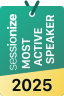
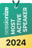
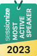

<!-- _class: lead -->
<!-- _paginate: false -->

<h1 class="cover-title">Aspire + Microsoft Foundry</h1>

## Two models, one AppHost, zero keys

**Emiliano Montesdeoca del Puerto**
<p class="event-name">.NET Conf 2026: Building the Next Generation of .NET Applications</p>

Cloud Experts Group · November 20 · 6:00 PM PHT

<!--
TIEMPO: 0:00 – 0:20

10 diapositivas: 9 de contenido y una de cierre.
Objetivo: 20 minutos de contenido y 5 de preguntas. La sesión es de 25 minutos con las preguntas
incluidas. Las tres demos son el centro de la charla.

Una frase: una web Blazor que pide una historia a gpt-6-luna y un dibujo a un modelo de imágenes,
los dos en Foundry, todo descrito en un AppHost de Aspire y sin una sola clave.

Agradecer a Cloud Experts Group por organizar el evento y conectar la charla con el futuro de .NET.
-->

---

<!-- _class: bio -->

## Hi, I'm Emi

<div class="bio-layout">
  <div class="bio-copy">
    <ul>
      <li>Born in Uruguay, Canarian at heart</li>
      <li>Cloud Solutions Team Lead · Intelequia</li>
      <li>Microsoft MVP in Developer Technologies since 2022</li>
      <li>Blogger / wannabe influencer</li>
    </ul>
    <div class="bio-badges">
      
      
      
      
    </div>
  </div>
  
</div>

<!--
TIEMPO: 0:20 – 0:45

Breve. Lo único que quiero que recuerden: ya no programo cada día; lidero un equipo, y lo que más me
importa es que cualquiera del equipo pueda clonar un repo de IA y ejecutarlo el primer día.
-->

---

<!-- _class: lead hook -->

<h1>What makes up an application?</h1>

<!--
TIEMPO: 0:45 – 0:55

Pregunta al público: "What makes up an application?" Dejar unos segundos para que piensen; todavía
no responder.
-->

---

<!-- _class: components -->

## An application is more than code
<br>
<div class="component-grid">
  <div class="component-card">Services</div>
  <div class="component-card">API keys &amp; secrets</div>
  <div class="component-card">Database</div>
  <div class="component-card">Environments</div>
  <div class="component-card">Local development</div>
  <div class="component-card">Deployment</div>
  <div class="component-card">AI models</div>
  <div class="component-card">Roles &amp; permissions</div>
  <div class="component-card">Configuration</div>
  <div class="component-card">Networking</div>
  <div class="component-card">Observability</div>
  <div class="component-card">CI/CD</div>
</div>
<br>
<p class="component-transition">We just want to build an app. Why are we already running into problems?</p>

<!--
TIEMPO: 0:55 – 1:10

Dejar que lean las cajas. No todas las aplicaciones necesitan todas estas piezas; por ejemplo, esta
demo no usa base de datos. La idea es que cada equipo acaba configurando y conectando varias cosas
antes de escribir código útil.
-->

---

## The problem

Every AI app needs the same setup before useful code:

1. Create Foundry and deploy both models in the portal.
2. Copy endpoints and deployment names into config; keys end up in `appsettings.json`, Slack or someone's `.env`.
3. Write down the steps so the next person repeats them.

**Works once. For one person. The next clone starts from zero.**

<!--
TIEMPO: 1:10 – 2:30

Pregunta al chat: ¿quién ha pegado alguna vez una API key en appsettings "solo para probar"?
Esperar dos segundos. Todos.

Esto lo hemos hecho todos. Como Team Lead, lo que me preocupa no es el portal: es que los pasos
vivan en la cabeza de una persona, que las claves se muevan por el chat y que el siguiente repita
todo. Aspire deja esa infraestructura descrita en el AppHost.
-->

---

<!-- _class: compact-logo -->

## What Aspire is

<div class="cols">
<div>

**A code-first way to describe your app and everything around it.**

- **AppHost**: a C# file with your projects, databases, AI models…
- **`aspire run`**: starts everything, wires it together
- **Dashboard**: resources, logs, traces
- **`aspire deploy`**: the same model, to Azure

</div>
<div>

```csharp
var builder = DistributedApplication
    .CreateBuilder(args);

var db = builder.AddPostgres("pg");

builder.AddProject<Projects.Web>("web")
       .WithReference(db)
       .WaitFor(db)
       .WithExternalHttpEndpoints();

builder.Build().Run();
```

</div>
</div>

<!--
TIEMPO: 2:30 – 4:00

Para quien no lo conoce: el AppHost es un programa de C#. No es YAML. Cada AddX es un recurso;
WithReference es "este proyecto necesita aquello" y Aspire le pasa la conexión como variables
de entorno. WaitFor espera a que la base de datos esté lista y WithExternalHttpEndpoints marca los
endpoints HTTP de la web como externos. Hoy en vez de Postgres pondremos Foundry.
El ejemplo de Postgres es solo para la idea.
-->

---

## What happens on `aspire run`

1. Reads the AppHost: **what** exists and **who needs what**
2. Creates the Azure resources that don't exist yet (first run only)
3. Gives you **roles**, not keys, on those resources
4. Starts your projects with the connection info as **environment variables**
5. Opens the **dashboard**: resources, console, structured logs, traces

<!--
TIEMPO: 4:00 – 5:00

Punto 2: la primera vez tarda unos minutos porque crea cosas en Azure de verdad. Por eso hoy
lo traigo ya creado. Punto 3 es la clave de la charla: la cuenta de Foundry se crea con la
autenticación local desactivada y Aspire asigna los roles. No existe ninguna clave que filtrar.
-->

---

<!-- _class: lead hook -->

<h1>It's demo time</h1>

<!--
TIEMPO: 5:00 – 19:25

DEMO 1 · Run locally (`aspire run`) · 5:00–12:25
Antes de empezar: Foundry y los dos despliegues YA creados (aspire run de la mañana), az login
hecho, la web calentada con una historia (la primera llamada tarda más).
Guion:
- Dashboard → Resources. Señalar foundry, story, image (en Azure) y web (en mi máquina).
- web → Environment. Buscar "KEY": no hay. Solo URI y nombres de despliegue.
- Abrir la web. Pedir al chat una idea; si nadie dice nada, la del faro.
- Mientras dibuja (unos segundos): "esto es el modelo de imagen trabajando".
Si falla: un intento de un minuto, luego vídeo de respaldo.

DEMO 2 · Observability · 12:25–13:55
Abrir la traza de la petición. Primero el span del chat (luna), luego la llamada HTTP a
images/generations. Enseñar cuál tarda más (la imagen). Esto sale de ServiceDefaults y del
switch de telemetría del SDK de OpenAI; no he escrito nada de telemetría a mano.

DEMO 3 · Now in Azure (`aspire deploy`) · 13:55–19:25
NO desplegar en directo desde cero: tarda varios minutos. Plan: lanzar `aspire deploy` y enseñar
la salida mientras habla, o enseñar el despliegue de la mañana (consola + URL pública).
Pedir otra historia en la URL pública. Punto clave: el mismo código, ninguna clave; ahora la
identidad es la de la app en Azure.
Si falla: vídeo de respaldo del deploy.
-->

---

## Summary

- **AppHost:** `AddFoundry`, `AddDeployment` and `WithReference`.
- **Web:** `DefaultAzureCredential`; no keys.
- **Run locally:** `aspire run`.
- **Deploy to Azure:** `aspire deploy`.

**Repo:** [aspire-foundry-netconf-cloud-experts-2026](https://github.com/emimontesdeoca/aspire-foundry-netconf-cloud-experts-2026)

<!--
TIEMPO: 19:25 – 20:00

La slide para la foto. Terminar el contenido en el minuto 20 y pasar a preguntas.
-->

---

<!-- _class: lead -->
<!-- _paginate: false -->

# Thank you

## Questions?

**Emiliano Montesdeoca**
linkedin.com/in/emimontesdeoca · @emimontesdeocaa

<!--
TIEMPO: 20:00 – 25:00

Cinco minutos de preguntas. Dejar esta slide puesta.

Preguntas previsibles:
- ¿Necesito Visual Studio? No: .NET 10 SDK + CLI de Aspire, vale VS Code o la terminal.
- ¿Funciona con Python o TypeScript? Sí: el AppHost puede ser TypeScript y los clientes Python/JS
  leen las mismas variables (STORY_URI, STORY_MODELNAME).
- ¿Y si mi empresa no me deja asignar roles? Tu usuario necesita crear recursos y asignar roles; si
  no, que alguien cree Foundry y lo usas con `AsExisting`.
- ¿Por qué no Aspire.OpenAI? Porque no soporta identidad gestionada; para Foundry en la nube la doc
  de Aspire usa el SDK de OpenAI directamente.
- ¿Cuánto cuesta? Los modelos se pagan por uso (tokens y por imagen); Container Apps escala a cero.
  Borra el grupo de recursos al terminar.

Si no sabes una respuesta: "I'll answer you on LinkedIn". Y hacerlo.
-->
